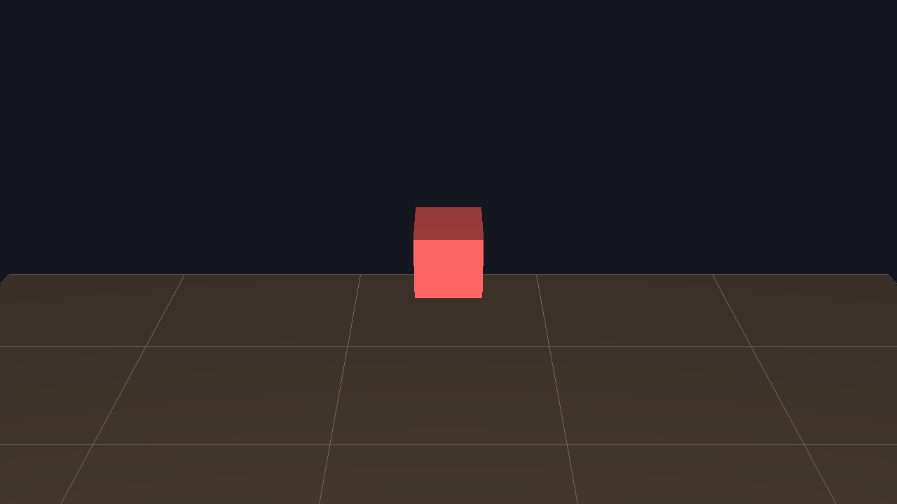
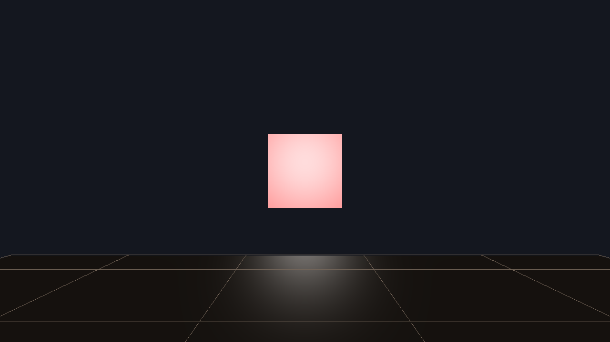
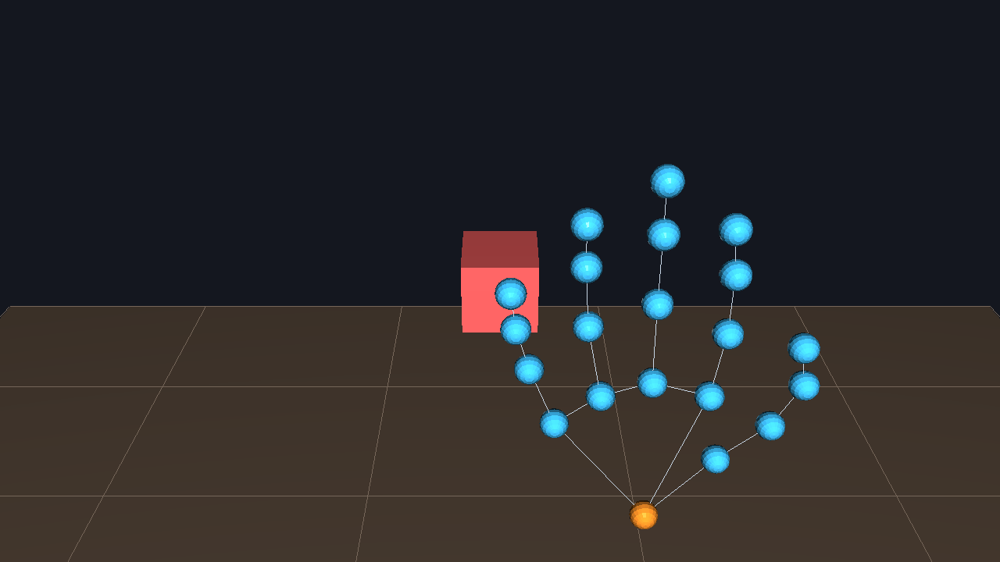
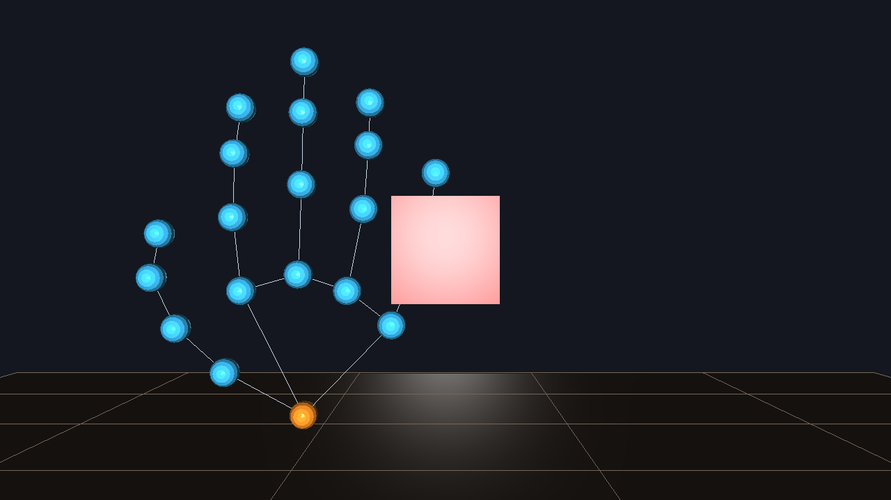

# B01 场景基线记录

测试日期为 2026年11月20日，测试电脑为当前 Windows 笔记本。现有 webcam 入口已运行，第一人称和相机视角各完成两轮采集。每种视角的两轮初始三维截图逐像素一致，相机内外参的最大绝对差均为 0，初始视图重复性通过。

立方体、桌面和固定关键点手骨架均已确认可显示。实际 webcam 预览持续全黑，四轮检测手数均为 0，因此真实手检测到骨架的完整链路仍需在镜头正常输出后复测。固定关键点截图用于检查渲染与坐标转换。

## 运行环境

| 项目 | 本次记录 |
| --- | --- |
| 系统 | Windows 11 家庭版 中文版，10.0.26200 |
| CPU | Intel Core Ultra 9 275HX |
| 内存 | 约 31.44 GiB，系统报告 33752997888 字节 |
| 已枚举显卡 | NVIDIA GeForce RTX 5080 Laptop GPU、Intel Graphics |
| 显示器模式 | 系统报告 2560×1600、240 Hz |
| Python | 3.10.11，独立虚拟环境 |
| Open3D / MediaPipe | 0.18.0 / 0.10.21 |
| NumPy / OpenCV | 1.26.4 / 4.11.0.86 |
| 摄像头 | Integrated Camera，设备号 0，MSMF 后端 |
| 摄像头报告帧率 | 30 FPS |
| 深度输入 | 无，`has_depth=false` |

本机测试解释器位于 `C:/Users/20981/.codex/environments/rgbd-hand-baseline/Scripts/python.exe`。原默认解释器为 Anaconda Python 3.9，缺少 MediaPipe 和 Open3D，本次建立了独立环境。

安装遵循业务目录的 `requirements.txt`，另将 MediaPipe 引入的 `opencv-contrib-python` 固定为 `4.11.0.86`，与项目的 `opencv-python` 对齐。完整安装版本保存在 [pip-freeze.txt](2026-11-20/pip-freeze.txt)，`pip check` 通过。硬件枚举见 [hardware.json](2026-11-20/hardware.json)，实际承担 OpenGL 渲染的 GPU 未单独测量。

## 入口与场景配置

从仓库根目录进入业务代码目录后运行。

```powershell
cd D:\rgbd-hand-test\rgbd_hand\rgbd_hand
$pythonExe = 'C:/Users/20981/.codex/environments/rgbd-hand-baseline/Scripts/python.exe'
& $pythonExe -X utf8 main.py --source webcam --view first
& $pythonExe -X utf8 main.py --source webcam --view camera
```

两条命令需依次运行。摄像头预览窗口中的 `q` 或 `Esc` 退出当前运行，`r` 复位物体。本次自动测量脚本直接调用 `main.main()`，使用同样的 webcam 参数，结束后关闭相机、MediaPipe、Open3D 和 OpenCV 窗口。每种视角的两轮在同一 Python 进程中重新创建并关闭整套应用资源。

| 项目 | 请求值或实测值 |
| --- | --- |
| `--width` / `--height` | 1280 / 720 |
| 实际摄像头帧 | 1280×720，BGR |
| Open3D 内部视口 / 保存截图 | 1280×720 |
| OpenCV 预览图像区域 | 960×540 |
| 窗口工具返回的 Open3D 截图尺寸 | 856×511 逻辑像素，含窗口边框和标题栏 |
| 窗口工具返回的 OpenCV 截图尺寸 | 643×391 逻辑像素，含窗口边框和标题栏 |
| 水平视场角 | 60° |
| Open3D 内参 | fx=fy=1108.5125168440816，cx=639.5，cy=359.5 |
| 立方体 | 边长 0.05 m，8 顶点、12 三角形 |
| 初始中心 | 相机系 `(0, 0.05, 0.42)` m，场景系 `(0, -0.05, -0.42)` m |
| 桌面 | 0.9×0.6 m，桌面相机系 y=0.18 m，中心 z=0.55 m |
| 手部显示配置 | 最多两只手，每只 21 个关节球和 21 条骨架连线 |
| 单个关节球 | 半径 0.009 m，182 顶点、360 三角形 |

相机系采用 +X向右、+Y向下、+Z向前，场景转换复用 `to_scene()` 的 `diag(1,-1,-1)`。第一人称视角的观察位置为场景系 `(0, 0.25, -0.92)` m，相机视角为 `(0, -0.05, -0.04)` m，均看向初始物体中心。第一人称下 webcam 预览使用现有自拍镜像配置。

## 初始视图与骨架截图

第一人称初始场景可见红色悬浮立方体、棕色桌面和网格，能够看到立方体顶面。相机视角正对立方体一面，桌面位于画面下方。两种视角均成功显示场景。





补充检查使用现有 `workbench_ui.demo_hand(x=-0.09, y=0.05, z=0.52)` 生成固定的 21 个三维点，直接传给真实 `Scene.update_hands()`。检查确认骨架点等于 `to_scene(points)`，21 个球心与相应变换后关键点重合，误差小于 `1e-10` m。两个视角的输入点完全相同。





固定点检查结果见 `first-fixture.json` 和 `camera-fixture.json`。真实摄像头的全黑预览证据见 [webcam-black-preview.png](2026-11-20/webcam-black-preview.png)。全黑原因需在本机确认，当前未确认镜头遮挡、物理开关或其他设备因素。

补充对设备号0分别使用MSMF和DSHOW读取40帧，两者均成功打开并返回1280×720图像。最后一帧的像素均值分别约18.03和17.35，标准差约0.91和0.62，均为接近全黑的低变化画面，切换后端后仍未获得正常场景。记录见 [camera-backend-check.json](2026-11-20/camera-backend-check.json)。

## 性能采样

每轮预热 3 秒，随后采样 20 秒。采样通过现有主循环执行相机读取、MediaPipe 检测、交互更新、OpenCV 预览与 Open3D 渲染。四轮均为无手、全黑摄像头输入，窗口保持初始视角。

| 视角与轮次 | 样本帧数 | 整体循环 FPS | 循环平均 ms | 循环 P95 ms | `Scene.render()` 平均 ms | `Scene.render()` P95 ms |
| --- | ---: | ---: | ---: | ---: | ---: | ---: |
| first 1 | 321 | 16.02 | 62.44 | 68.05 | 11.15 | 13.23 |
| first 2 | 332 | 16.55 | 60.41 | 67.42 | 11.11 | 13.62 |
| camera 1 | 330 | 16.50 | 60.61 | 70.17 | 11.19 | 13.86 |
| camera 2 | 349 | 17.40 | 57.48 | 67.28 | 9.97 | 12.78 |

整体 FPS 按 `1000 / 平均循环毫秒` 计算。脚本 CSV 中 `loop_ms` 记录上次渲染结束至本次渲染开始的间隔，再加本次 `render_ms` 得到表中完整循环耗时。截图读回耗时从采样区间排除。`Scene.render()` 耗时覆盖其事件处理和渲染更新调用。首帧启动耗时记录在 JSON 中，从进入应用主函数开始，Python 模块导入发生在该计时之前。

这些结果用于后续在相同输入条件下比较修改前后开销。含真实手、手部运动或雕刻操作时需另行采样。Open3D 窗口在观察时被摄像头预览遮挡了一小部分，保存的三维截图由 Open3D 直接生成，尺寸均为 1280×720。

## 重复性与验收结果

| 检查项 | 结果与证据 |
| --- | --- |
| webcam 流程启动及正常退出 | 四轮返回码均为 0，重复打开摄像头成功 |
| 立方体与桌面 | 两种视角截图均确认显示 |
| 手骨架绘制与坐标转换 | 固定关键点检查通过，两种视角均有截图 |
| first 重复启动 | 初始截图逐像素一致，内参与外参差值均为 0 |
| camera 重复启动 | 初始截图逐像素一致，内参与外参差值均为 0 |
| 真实手检测并驱动骨架 | 待复测，四轮最大检测手数均为 0，摄像头预览全黑 |

重复性数据保存在 [first-repeatability.json](2026-11-20/first-repeatability.json) 和 [camera-repeatability.json](2026-11-20/camera-repeatability.json)。结论对应本次分辨率、设备、初始参数和无手场景。

## 重新采集

```powershell
cd D:\rgbd-hand-test\rgbd_hand\rgbd_hand
$pythonExe = 'C:/Users/20981/.codex/environments/rgbd-hand-baseline/Scripts/python.exe'
& $pythonExe -X utf8 docs/baseline/collect_baseline.py --view first --runs 2 --seconds 20 --output docs/baseline/retest-first
& $pythonExe -X utf8 docs/baseline/collect_baseline.py --view camera --runs 2 --seconds 20 --output docs/baseline/retest-camera
& $pythonExe -X utf8 docs/baseline/collect_baseline.py --view first --fixture --output docs/baseline/retest-fixture
& $pythonExe -X utf8 docs/baseline/collect_baseline.py --view camera --fixture --output docs/baseline/retest-fixture
```

在其他电脑上，可用 Python 3.10 创建环境，并以 `python -X utf8 -m pip install -r requirements.txt opencv-contrib-python==4.11.0.86` 安装本次使用的核心依赖。`pip-freeze.txt` 提供本次完整环境版本。

每次复测指定新的输出目录。脚本的 `--fixture` 模式需要当前项目中的 `workbench_ui.py`。真实手复测时，先确认预览正常，再将张开的手放入画面，脚本检测到手后会额外保存 `*-hand.png`。该截图将包含真实输入驱动的三维骨架；若手在初始帧已出现，初始截图也会随手部姿态变化，应结合相机矩阵检查视角重复性。

原始证据位于 `2026-11-20/`，包含每轮 CSV、JSON、截图、运行日志、环境版本及硬件记录。基线业务代码对应 Git 提交 `a8bef33df3aea1d2177e14d7cfe32773c3920749`，当前 `main.py` 与 `render/scene.py` 的 SHA256 见 [environment.json](2026-11-20/environment.json)。本轮交付新增采集脚本与记录，业务代码的文件哈希与测试前一致。
