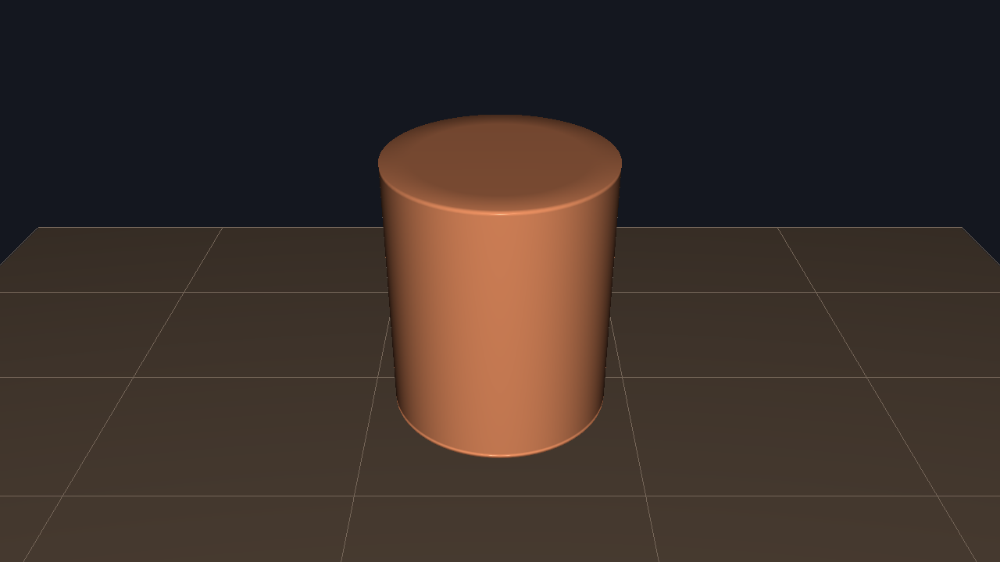
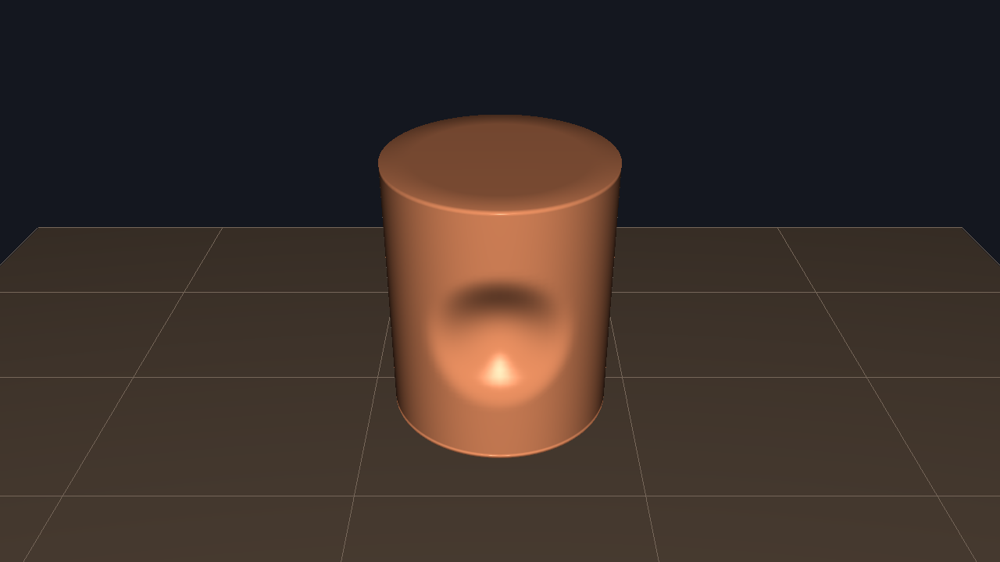
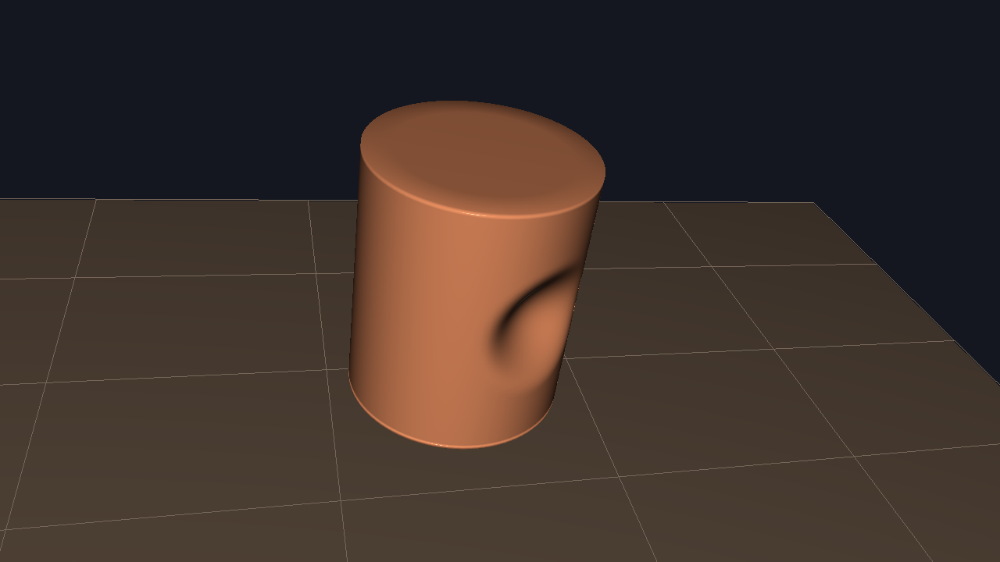

# B02 B03 可编辑圆柱与场景刷新

2026年11月22日完成不依赖相机的圆柱场景、局部顶点提交、刚体位姿更新与复位。入口是 `clay_demo.py`，仍保留 `main.py` 原立方体演示。真实手驱动、射线拾取及连续雕刻不属于本次验收。

## 启动与操作

在 PowerShell 运行：

```powershell
cd D:\rgbd-hand-test\rgbd_hand\rgbd_hand
$pythonExe = 'C:/Users/20981/.codex/environments/rgbd-hand-baseline/Scripts/python.exe'
& $pythonExe -B -X utf8 clay_demo.py
```

也可在项目 Python 3.10 环境使用 `python clay_demo.py`。不访问摄像头、不运行 MediaPipe 检测、不依赖模型权重；使用现有 Open3D 0.18.0 和 NumPy。

| 操作 | 行为 |
| --- | --- |
| D | 在初始形状上放置固定演示凹坑，重复按不累计深度 |
| R | 复位形状和泥坯位姿，保留当前观察视角 |
| A / F | 泥坯绕局部竖直轴向两侧转动，每次约 8.6° |
| V | 恢复该模式的初始观察视角 |
| 鼠标左键拖动 / 滚轮 | Open3D 原生旋转观察 / 缩放 |
| W | Open3D 原生线框切换 |
| Q / Esc | 退出窗口 |

第二视角使用 `python clay_demo.py --view camera`。默认第一人称模式从局部 -Z 一侧看，camera 从 +Z 一侧看，固定凹坑相应放在各自可见的一侧。切换模式需重新启动。

细分可用 `--radial-segments 96 --height-segments 48 --cap-segments 4` 调整，尺寸可用 `--radius 0.075 --height 0.18` 调整。尺寸单位米；默认场景按默认尺寸构图，极大尺寸可能需要滚轮缩小观察。

## B02 几何约定

`render/clay_mesh.py` 中的 `ClayMesh` 使用局部 +Y 轴，原点在几何中心。默认半径 0.075 m、高 0.18 m。11月22日的基线中心为 `(0, -0.09, -0.50)` m，底面位于桌面 y=-0.18 m。11月25日工作室场景增加 28 mm 转盘后，默认中心为 `(0, -0.062, -0.50)` m，底面位于转盘顶面 y=-0.152 m，详见 [视觉更新](studio-design.md)。

令 n 为周向段数、h 为高度段数、c 为端面径向段数：

- 顶点数 `n * (h + 1 + 2 * (c - 1)) + 2`，默认 **5282**。
- 三角形数 `2*n*h + 2*n*(2*c - 1)`，默认 **10560**。
- 侧面有 h+1 个环，每环 n 点，用角度索引取模连接接缝；不重复创建 0°/360° 点。
- 上下端面复用侧面末端环，各有 c-1 个内部环和一个中心点。
- 每条边属于两个面，绕向相反；初始网格闭合、无重复顶点、无退化面、无自交。
- 顶点顺序固定；`side_vertex_indices` 包含侧面及其上下边界环。D 若要排除端面边界，应另外限制 `abs(y) < height/2`。

初始顶点、当前顶点和三角形 getter 均返回副本，避免调用方静默改动形状而漏更新版本。拓扑在更新过程中不变。共享边界采用平滑顶点法线，因此端面边缘有视觉上的圆润过渡，几何仍是直角圆柱。

## B03 更新接口

```python
import numpy as np
from render import ClayMesh, Scene

clay = ClayMesh()
pose = np.eye(4)
pose[:3, 3] = [0, -0.09, -0.5]
clay.set_pose(pose)
scene = Scene(clay=clay, focus_distance=.5, look_at_y=.09)
try:
    vertices = clay.vertices_local  # 副本，D 在局部坐标中计算变形
    # ... 修改 vertices ...
    scene.update_clay(vertices_local=vertices)
    while scene.render():
        pass
finally:
    scene.close()
```

| 接口 | 语义 |
| --- | --- |
| `clay.vertices_local` / `initial_vertices` / `triangles` | 当前局部形状、初始形状、固定拓扑的副本 |
| `clay.set_vertices(vertices)` | 提交完整有限 N×3 顶点数组，禁止改变顶点数量 |
| `clay.pose_scene` / `set_pose(T)` | 局部到场景的刚体 4×4 位姿；拒绝缩放、镜像和非法矩阵 |
| `scene.update_clay(vertices_local=None, pose_scene=None)` | 提交并刷新；两项均不传时同步 ClayMesh 已提交的修改 |
| `scene.render()` | 自动同步未显示的网格版本并处理窗口事件 |
| `clay.mesh_local(initial=False)` | 当前或初始的独立局部 Open3D 网格，含法线 |
| `clay.mesh_scene()` | 当前形状经过当前位姿后的独立场景网格，供 E 拾取 |
| `clay.shape_version` | 形状变化递增 |
| `clay.version` | 形状或位姿变化均递增，E 可据此重建拾取网格 |
| `clay.reset()` | 只恢复形状，保留位姿 |
| `scene.reset_clay()` | 恢复初始形状及创建场景时的位姿 |

显示公式为 `V_scene = V_local @ R.T + t`。局部坐标已经是 +Y 向上，`pose_scene` 已是场景位姿，**不能再对它重复调用 to_scene()**。原手部和立方体仍使用相机坐标及原有 `diag(1,-1,-1)` 转换。E 对命中点使用该位姿的逆矩阵转到局部空间，法线用逆旋转。

形状变化时重算法线；只改变位姿时旋转缓存的局部法线。同一个 `clay_visual` 原地更新，不删除重建几何体，不重设相机，不从初始形状覆盖凹坑。实际刷新遵循 Open3D 的 [update_geometry 接口](https://www.open3d.org/docs/0.18.0/python_api/open3d.visualization.VisualizerWithKeyCallback.html)。

当前接口由渲染进程/线程顺序调用，不提供跨线程同步。E 应在提交修改后按 `version` 获取当前网格并刷新拾取场景；修改读取网格副本不会自动修改显示。

## 验收与证据

```powershell
& $pythonExe -B -X utf8 -m unittest discover -s tests -v
& $pythonExe -B -X utf8 clay_demo.py --verify-dir docs/clay/retest-first
& $pythonExe -B -X utf8 clay_demo.py --view camera --verify-dir docs/clay/retest-camera
```

本次 Python 3.10.11、Open3D 0.18.0、NumPy 1.26.4。三个自动测试覆盖三种细分的闭合拓扑与朝向、形状/位姿/版本与副本隔离，以及非法输入拒绝。

两种视角都执行真实 Open3D 窗口验收：初始圆柱 → 固定局部凹坑 → 泥坯旋转 → 观察视角旋转 → 复位。默认凹坑改变 405 个顶点，最大位移 0.022 m。断言证明凹坑在姿态与视角变化后保留，显示顶点与提供给拾取的当前场景网格一致，显示对象被复用，复位恢复初始形状及位姿。

截图及机器可读结果在 `2026-11-22/first/` 和 `2026-11-22/camera/`，`verification.json` 中的 `shape_update_ms` 仅为一次提交与 CPU 几何更新耗时，不是完整帧耗时，也不作为 B05 性能结论。原立方体和固定手骨架的兼容检查保存在 `2026-11-22/legacy/`。







后续 B04 接 E 的命中点/法线与笔刷范围，B05 测量连续变形与拾取同步开销。`demo_dent()` 是显示验证夹具，正式挖坑、平滑与笔画管理由 D/E 接入。
