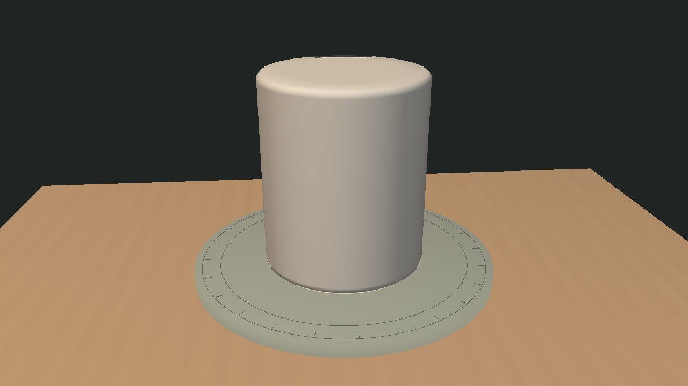
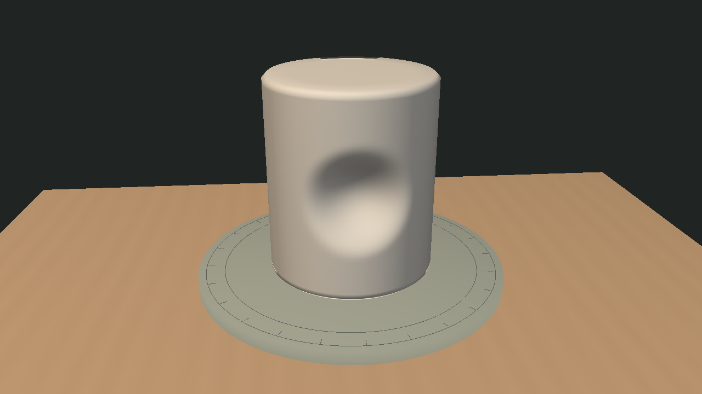

# 陶艺工作室视觉更新

2026年11月25日，泥坯场景和工作台统一为暖灰、浅木色与鼠尾草绿的陶艺工作室风格。运行入口不变：`python main.py` 或 `python workbench_ui.py`。

三维场景采用灰陶色、无镜面高光的漫反射光照，加入侧向主光和补光。使用现有 Open3D Visualizer；不包含 PBR 材质、实时阴影或贴图资源。木桌通过低幅度顶点颜色表现细纹，盘面使用低对比环线与刻度。

泥坯下方为 28 mm 高的双层陶艺转盘。`render.studio.clay_studio_pose()` 统一设置泥坯初始位姿，保证底面位于转盘上表面；桌面仍在相机 y=0.18 m / 场景 y=-0.18 m。默认泥坯中心场景坐标为 `(0, -0.062, -0.5)` m。转盘属于静态装饰几何，不参与雕刻网格、拾取或导出。

`ClayMesh` 新增可选参数 `edge_rounding`，默认 0，保持直接调用构造函数的直角圆柱行为。工作台和独立泥坯演示使用 4 mm 圆角，调整侧面边缘环及共享端面外环的半径，不增加顶点或改变三角形索引。网格仍有 5282 顶点和 10560 三角形，局部形状/位姿/复位接口不变。低细分时圆角近似程度取决于高度采样。

工作台调整包括：中文品牌与输入源名称；下方统一工具栏；侧栏优先显示半径、深度、已应用值及输入状态；无相机演示时隐藏相机占位区；网格开关、顶点数和版本默认折叠。参考网格默认关闭。视图保持宽高比，并在高 DPI、大窗口下同步放大；三维窗口最小化返回无效帧时保留最后有效画面并提示恢复。

主要修改位置：

- `render/studio.py`：静态桌面和转盘、初始泥坯位姿。
- `render/studio_render.json`：背景与 Open3D 光源参数。
- `render/clay_mesh.py`：灰陶色与可选圆角。
- `render/scene.py`：场景组合和构图，原 cube 模式保留旧桌面/光照。
- `workbench_ui.py`：配色、布局、工具栏与中文状态。

验证：网格拓扑与圆角闭合性、转盘接触高度、暂停复位与参数应用、最小化预览回退均有回归检查；两种视角的固定凹坑、位姿变化及复位通过实际 Open3D 窗口验证；spawn/队列集成脚本覆盖现有输入恢复和资源退出。真实 Tk 窗口另检查新工具栏凹坑与信息折叠。真实相机识别与手势雕刻不属于本次视觉验收。

